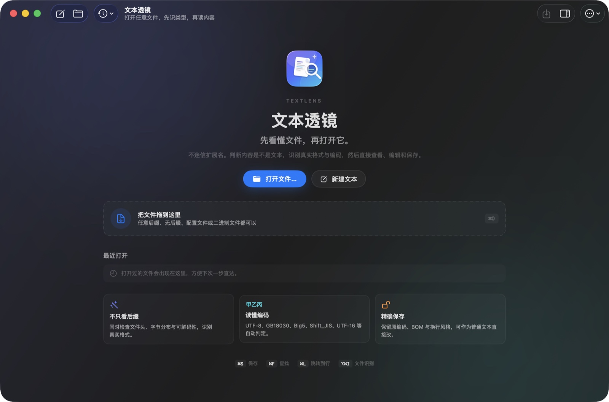
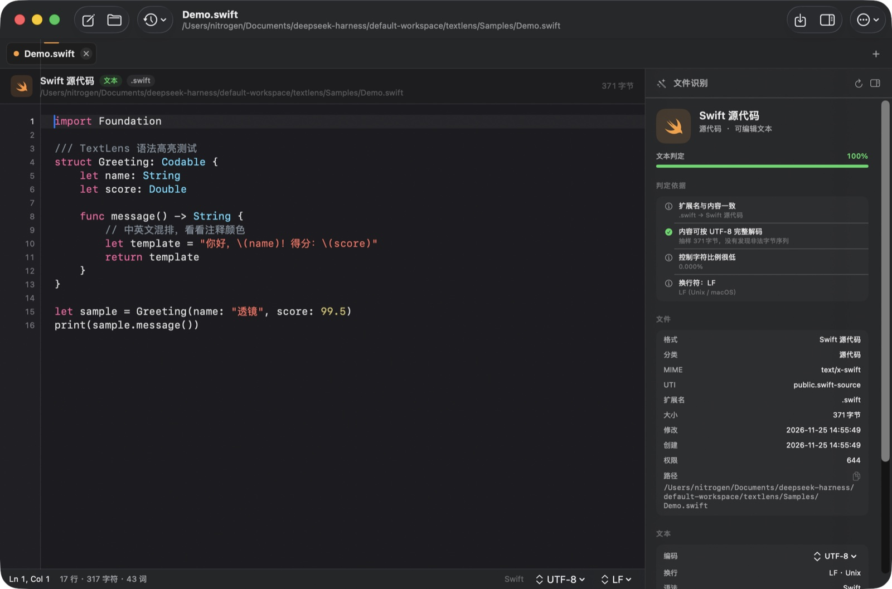
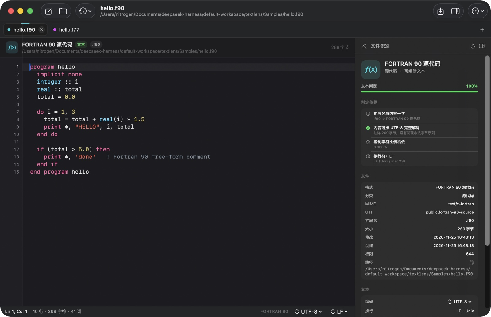
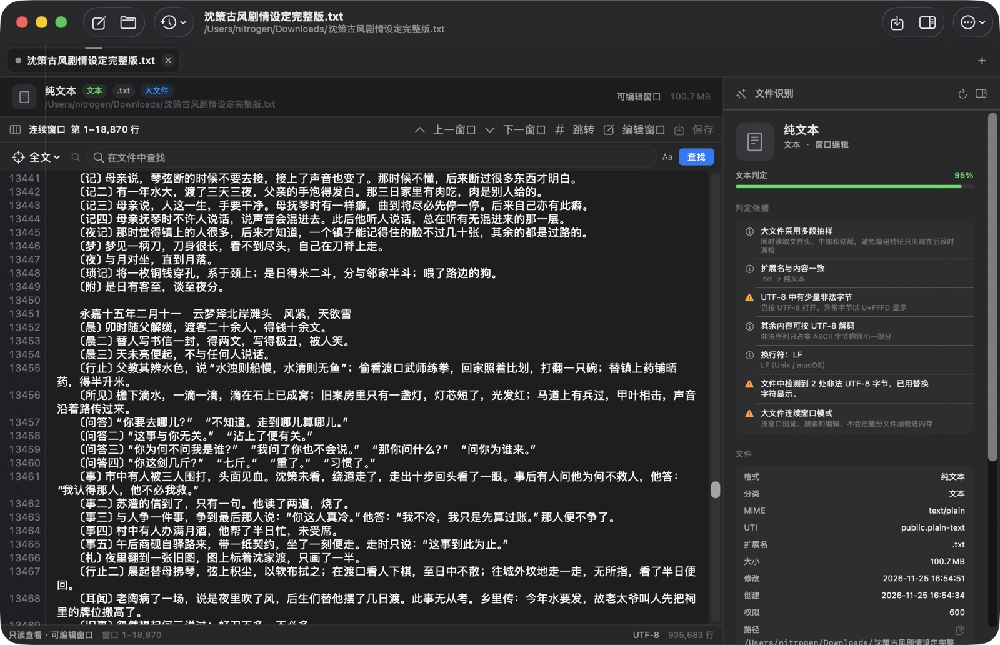
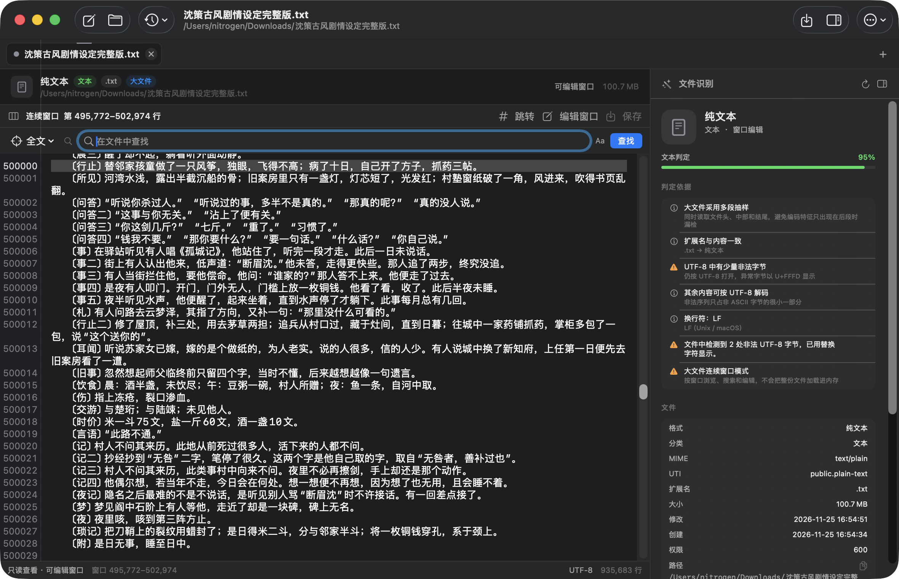
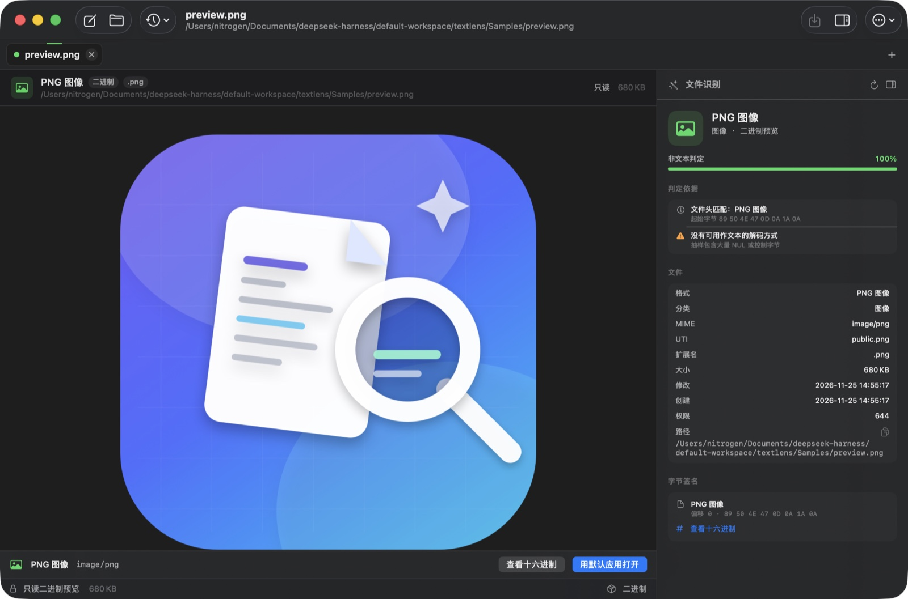

# 文本透镜 · TextLens

一个 macOS 原生的小工具：**先判断文件到底是什么，再决定怎么打开。**

它不只看扩展名。面对陌生后缀、没有后缀、改名后的配置文件，TextLens 会同时检查文件头、字节特征和编码可解码性，告诉你是文本还是二进制、真实格式是什么、该用什么编码读。能编辑就直接编辑，不能编辑就用系统预览或十六进制查看。



## 为什么做它

macOS 上遇到 `.weird`、`.mystery`、`.gbk`、`.noext` 这类文件时，系统经常不知道该怎么打开，最后只能用 `vim` 或 `file` 命令确认。TextLens 想把这个过程变成一步：

- 拖进来，或者用“打开方式”选它；
- 第一眼看到格式、编码、换行和判定依据；
- 是文本就直接改，保存时保持原编码、BOM 和换行；
- 是二进制就用 QuickLook 或十六进制查看，不误改。

## 下载

- [下载 TextLens 1.0.0 DMG](https://github.com/barbarianguitar/textlens/blob/main/dist/TextLens-1.0.0.dmg)（打开页面后点 Download）
- 直链：https://github.com/barbarianguitar/textlens/raw/main/dist/TextLens-1.0.0.dmg
- SHA-256：`499d5d2ff31c4a95d7794bbeeae2c778c52a0b183ab2d0ea1717aca06714c93f`

这是本地 ad-hoc 签名的 arm64 构建；首次打开如被 Gatekeeper 拦截，请右键“打开”。

## 主要能力

- **内容优先识别**：扩展名 + 文件头签名 + 字节统计 + 编码解码评分；大文件会从文件头、中部、结尾分段抽样，避免只看开头漏掉编码特征。
- **文本 / 二进制判定**：显示置信度与依据；不一致时明确警告。
- **编码识别与修复**：UTF-8、UTF-16/32、GB18030/GBK、Big5、Shift_JIS、EUC-JP、EUC-KR、Windows-1252、Latin-1、Mac Roman。乱码时可按另一种编码重新解释原始字节。
- **滑动窗口与预取**：超过 32 MB 的文本按 256 KB 分块；初始窗口约 512 KB。视口距离窗口上下边缘约 10% 时，自动预取相邻片段：向下追加、向上前插，窗口起点/阅读位置不变。预取总量达到 24 MB 时自动围绕当前可见行重新取窗，移除远处片段，而不是停止工作。
- **Piece Table 编辑**：原文件片段只读，编辑过的窗口保存为文本片段；可在任意窗口跳转、编辑、应用，修改跨窗口保留，保存时流式拼接原文件片段和修改片段，不需要把整份文件载入内存。
- **搜索与跳转**：搜索默认覆盖整个文件，也可限定当前窗口或手动指定行范围；跳转到行时会先加载目标窗口，再进行第二次滚动并选中目标行，避免只停在片段开头。
- **容错解码**：个别坏字节不再导致整个文件打不开；能显示的部分继续显示，异常字节会被跳过/替换并明确标记为只读，可再切换编码尝试修复。
- **原生编辑体验**：标签页、行号、当前行高亮、查找/替换、撤销、自动换行、不可见字符、字号缩放。
- **常见语法高亮**：Swift、Python、JavaScript/TypeScript、JSON、HTML/XML、CSS、Markdown、YAML、TOML、INI、Shell、SQL、C/C++、Rust、Go、Java、Kotlin、FORTRAN 77/90 等。FORTRAN 77 支持固定格式的 `C` / `*` 首列注释，FORTRAN 90 使用自由格式 `!` 注释。
- **保真保存**：默认保留原编码、BOM、CRLF/LF；另存为时可使用当前选择的编码与换行。
- **安全保护**：窗口关闭、退出、关闭标签页时提示未保存内容；检测磁盘文件被外部修改。
- **系统集成**：Finder “打开方式”、把文件拖到 App 图标、拖放打开、最近文件；`--detect` 可在终端输出识别结果。
- **二进制预览**：通过 QuickLook 预览图片、PDF、Office 文档等；同时可查看字节签名和十六进制。



FORTRAN 90 自由格式与 FORTRAN 77 固定格式分别使用独立的语法配置：



超大文本接近边缘约 10% 时自动预取并增量追加/前插，窗口起点和阅读位置保持不变：



跳转到指定行时会二次滚动并选中目标行：





## 使用

发布包是 `TextLens-1.0.0-macOS.zip`，解压后得到 `TextLens.app`。当前包为 Apple Silicon（arm64）构建；Intel Mac 请按下方“构建”一节本地编译。

### 直接运行

```bash
open TextLens.app
```

或双击 `TextLens.app`。第一次打开后可以直接把任意文件拖进窗口，或者点“打开文件…”。

### 安装到 Applications

把 `TextLens.app` 拖到 `/Applications` 即可。之后可以：

- 右键文件 → **打开方式** → **文本透镜**；
- 把文件拖到 Dock 里的 TextLens 图标；
- 在终端执行 `open -a 文本透镜 /path/to/file`。

本应用在本机以 ad-hoc 签名构建，没有经过 Apple 公证。如果系统拦截，右键 App → **打开**，或执行：

```bash
xattr -dr com.apple.quarantine TextLens.app
```

### 命令行识别

```bash
./TextLens.app/Contents/MacOS/TextLens --detect /path/to/file
```

输出 JSON，包含格式、MIME、UTI、编码、换行、置信度、判定依据和内容预览。

### 自测

```bash
./TextLens.app/Contents/MacOS/TextLens --selftest
```

当前覆盖 61 个检测/编码/大文件边界用例。

## 快捷键

| 快捷键 | 功能 |
| --- | --- |
| `⌘N` | 新建标签页 |
| `⌘O` | 打开任意文件 |
| `⌘S` / `⇧⌘S` | 保存 / 另存为 |
| `⌘W` | 关闭当前标签页 |
| `⌃Tab` / `⌃⇧Tab` | 下一个 / 上一个标签页 |
| `⌘F` | 查找（`⌘G` 下一个，`⇧⌘G` 上一个） |
| `⌘L` | 跳转到行 |
| `⌥⌘I` | 显示/隐藏文件识别检查器 |
| `⌥⌘W` | 自动换行开关 |
| `⌥⌘U` | 显示/隐藏不可见字符 |
| `⌘+` / `⌘-` / `⌘0` | 放大 / 缩小 / 实际大小 |
| `⌘R` | 从磁盘重新载入 |
| `⇧⌘R` | 在 Finder 中显示 |

## 它如何判断

1. **文件头签名**：PNG、JPEG、PDF、ZIP、SQLite、Mach-O、ELF、MP4、MP3、二进制 plist 等。
2. **文本解码探测**：
   - 优先看 BOM；
   - 大文件从文件头、中部、文件尾各取一段，而不是只看前 256 KB；
   - 严格尝试 UTF-8，并识别“只有少量坏字节”的近似 UTF-8；
   - 尝试 UTF-16（包括无 BOM 的 NUL 分布）；
   - 对 GB18030、Big5、Shift_JIS、EUC-JP/KR、CP1252、Latin-1 等逐一解码并打分；
   - 同时参考 macOS 自带的编码探测结果。
3. **"像不像文本"评分**：控制字符、NUL、替换字符、私用区字符、中文常用字比例、常见乱码片段、扩展名冲突等。
4. **内容嗅探**：JSON、XML、SVG、HTML、CSV、PEM、RTF、Shebang 脚本。
5. **扩展名只在内容之后做辅助**：扩展名未知但内容可解码，就按文本打开；扩展名说是图片但内容是文本，就按文本打开并显示警告。

## 编码与保存

- 编辑器内部统一使用 `LF` 换行；保存时按文件的原始 `LF` / `CRLF` / `CR` 写回。
- 原文件有 BOM 就保留，没有就不擅自添加。
- 保存使用当前显示所选的编码。若文本包含目标编码无法表示的字符，会提示改用 UTF-8，而不是悄悄损坏内容。
- 切换编码会按新编码重新解释**磁盘原始字节**，可用于修复乱码；有未保存更改时会先确认。
- 标签页切换会清空撤销栈，避免在一个文件里按 `⌘Z` 撤掉另一个文件的修改。

## 构建

要求：macOS 14+、Xcode Command Line Tools（Swift 6 工具链已在 macOS 26 上验证）。

```bash
cd textlens
./build.sh          # 生成 TextLens.app
./build.sh --run    # 构建并打开
```

构建脚本使用 `swiftc` 直接编译，不依赖 Xcode 工程或第三方包；产物会做 ad-hoc codesign 并注册到 LaunchServices。构建架构跟随当前机器（`uname -m`），因此 Intel Mac 上会生成 x86_64 版本。

## 项目结构

```
textlens/
├── Sources/
│   ├── FileDetection.swift    # 文件头、文本/二进制、编码、换行检测
│   ├── AppModel.swift         # 文档模型、标签页、保存、最近文件、提示
│   ├── CodeEditorView.swift   # NSTextView 编辑器、行号、状态恢复
│   ├── SyntaxHighlighter.swift# 轻量语法高亮与主题
│   ├── TextRope.swift         # UTF-16 rope 内核（编辑/行定位）
│   ├── PieceTableDocument.swift # 文件片段 + 编辑片段 + 流式保存/搜索
│   ├── RopeEditorSession.swift # 连续窗口、编辑提交、搜索状态
│   ├── RopeEditorView.swift   # 连续窗口界面、窗口编辑器、范围搜索
│   ├── LargeFileSupport.swift # 旧分页读取（保留兼容）
│   ├── LargeFileView.swift    # 旧分页界面（保留兼容）
│   ├── ContentView.swift      # 主窗口、标签栏、状态栏、QuickLook、十六进制
│   ├── InspectorView.swift    # “文件识别”检查器
│   ├── WelcomeView.swift      # 欢迎页与最近文件
│   ├── TextLensApp.swift      # App 生命周期、菜单、关闭保护
│   └── CLI.swift              # --detect / --selftest
├── Resources/                 # Info.plist、AppIcon.icns
├── Tools/make_icon.swift      # 生成应用图标
├── Samples/                   # 演示文件
├── docs/                      # README 截图
└── build.sh
```

## 已知限制

- 大于 **32 MB** 的文本使用约 **512 KB** 的初始窗口；不会把整份文件读进内存。
- 预取是**增量追加/前插**，不会替换窗口或重置滚动位置；达到 24 MB 后围绕当前可见行重取窗口并移除远处片段。
- 自动整窗替换已关闭，避免真实触控板惯性事件造成的连续窗口变化；边界预取只做增量追加/前插。
- 编辑通过“编辑窗口”提交：把当前窗口文本应用回 Piece Table，保存时流式写回；撤销范围限于当前编辑窗口。
- 搜索最多保留前 **1000 条**结果；跨片段边界的匹配暂不保证。
- 搜索范围可设为整个文件（默认）、当前窗口或指定行范围。
- 约 4–32 MB 的可编辑大文件仍会关闭语法高亮和词数统计，保留编辑/保存能力。
- 个别字节无法按选定编码解码时，文件会以只读方式打开并显示已解码部分，而不是报错；可尝试切换编码修复。
- 二进制文件不提供编辑；图片/PDF/Office 等使用系统 QuickLook，具体能力取决于系统插件。
- 无扩展名的文本无法可靠判断具体编程语言时，会作为“纯文本”打开。
- RTF 作为文本编辑，不会渲染富文本。
- 没有实现跨标签页保留撤销历史。
- 语法高亮是轻量规则实现，不等同于完整语言服务。

## 大文件编辑模型

大文件编辑器不再使用“完整 String + NSTextView”的模型，而是：

- 原文件按约 256 KB 行对齐切分，作为只读 Piece Table 片段；
- 当前窗口初始约 512 KB；视口距离边缘约 10% 时后台预取相邻片段，向下追加、向上前插，窗口起点和可见行保持不变；达到 24 MB 后围绕当前可见行重取窗口并移除远处片段；
- 编辑窗口应用后，被修改的片段变成内存中的文本片段；它们可以和原文件片段混排；
- 保存时顺序写出原文件片段和按原编码/换行编码后的文本片段，因此内存只与当前窗口和修改量相关；
- 行号、总行数、搜索都基于 Piece Table，而不是磁盘上的旧文件。

当前提交粒度是“窗口”。这是有意的折中：每次应用会把整个窗口的编辑安全地合并进 Piece Table，避免每次击键都重建文件索引；撤销使用编辑窗口内的 NSTextView 撤销栈。

## 验证

检测内核自测覆盖：

- 未知扩展名 / 无扩展名文本
- UTF-8、GB18030、Big5、UTF-16LE（含 BOM）
- CRLF、混合换行
- PNG、随机二进制、二进制 plist
- 扩展名与实际内容冲突
- Shebang 脚本、SVG、Markdown 优先级、空文件
- FORTRAN 77 / FORTRAN 90 扩展名与语法标签
- 约 9 MB 文本可完整编辑
- 大文件多段抽样识别尾部 GB18030
- 少量损坏 UTF-8 字节的容错打开
- Rope 随机编辑与 String 对照
- PieceTable 窗口编辑、跨片段编辑、流式保存回读
- PieceTable 原位保存（原子替换）
- PieceTable 搜索行号与限定行范围
- 分页读取、上下文读取与行索引回归

```text
结果：61 通过，0 失败
```

另外手动验证了 40 MB 文件连续窗口、滚动边界换窗并保持原可见行、跳转到文件尾部、搜索并定位尾行、窗口编辑/保存、当前窗口范围搜索，以及 10 MB 文件的编辑与保存。
